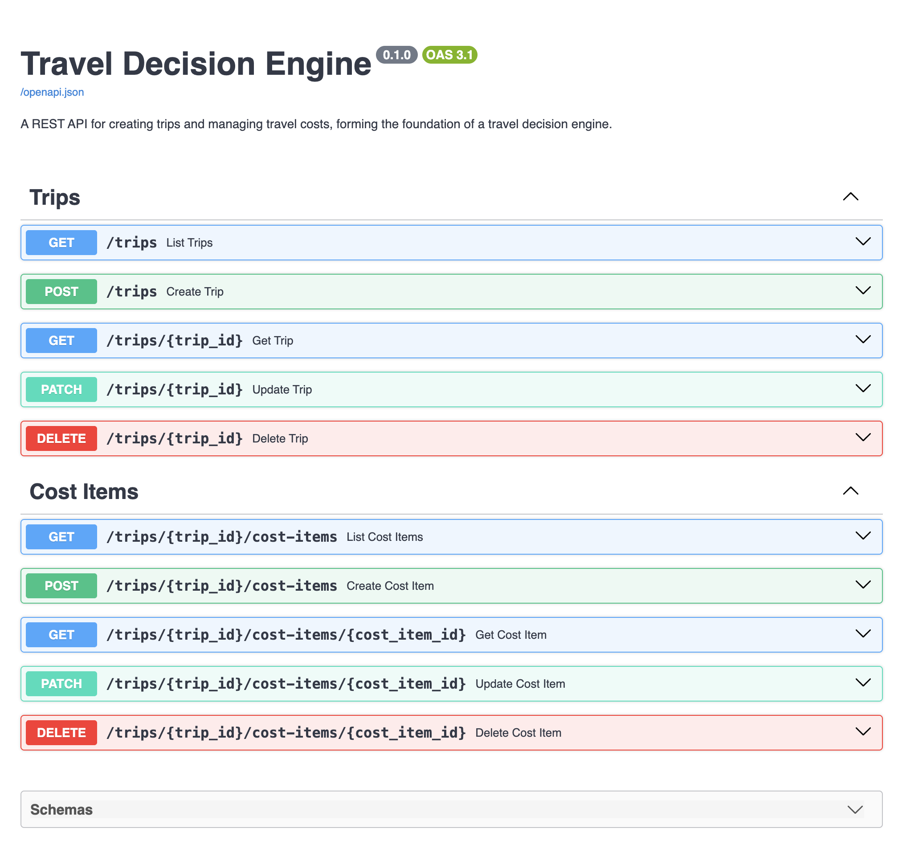

# Travel Decision Engine

A FastAPI-based travel planning application designed to model trips, calculate costs under different assumptions, and compare the financial trade-offs between travel options.

## 🚀 Project Vision

Travel planning information is often scattered across notes apps, spreadsheets, booking websites, and calculators.

Travel Decision Engine provides a structured way to model potential trips and understand the financial consequences of different choices. Users provide assumptions such as trip duration, traveller count, and estimated costs, while the engine calculates and compares the resulting trade-offs - leaving the final decision to the user.

## ✨ Features & Roadmap

### Implemented

* Trip Modelling - Create and manage trips with destination, duration, and traveller count
* Cost Item Management - Add and manage one-off, per-day, and per-night costs, with shared and per-person pricing
* Backend Foundation - SQLModel and SQLite persistence, Pydantic validation, automated Pytest testing, and GitHub Actions CI

### Planned

* Dynamic Cost Engine - Calculate total, per-person, category, and individual cost breakdowns
* Scenarios - Create alternative trip versions by adjusting duration, traveller count, or included costs
* Comparison & Decision Support - Compare travel options and highlight factual financial trade-offs without subjective recommendations

## 📖 API Preview



## 🛠 Tech Stack

* Python 3.11
* FastAPI - REST API framework
* SQLModel - Database modelling
* SQLite - Database
* Pydantic - Data validation
* Pytest - Testing framework
* GitHub Actions - Continuous Integration (CI)

## 🎯 V1 Scope

V1 focuses on building a working travel decision engine, prioritising backend logic, cost calculations, and structured API design, supported by a lightweight frontend for interacting with the application.

To keep the initial release focused, V1 intentionally excludes:

* Live travel pricing, web scraping, and external booking integrations
* User authentication and account management
* AI-generated itineraries and subjective travel recommendations
* Complex group travel and destination data integrations

## ⚙️ Getting Started

**Clone the repository**
```bash
git clone https://github.com/DylanFernandes98/travel-decision-engine.git
cd travel-decision-engine
```
**Create and activate a virtual environment**
```bash
python3.11 -m venv .venv
source .venv/bin/activate
```
**Install dependencies**
```bash
pip install -r requirements.txt
```
**Run the API**
```bash
uvicorn app.main:app --reload
```
Open `http://127.0.0.1:8000/docs` to explore the API through FastAPI's interactive Swagger documentation.

**Run the tests**
```bash
python -m pytest
```
